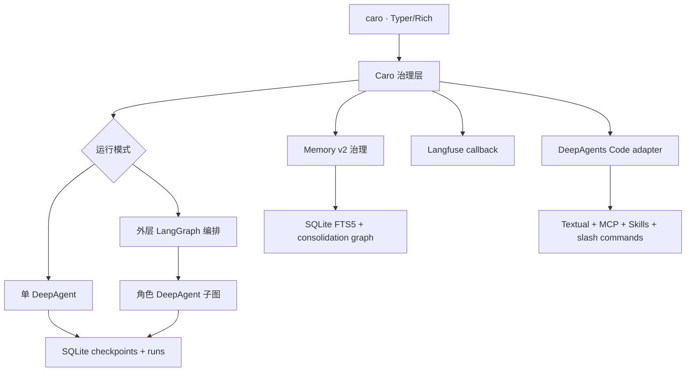
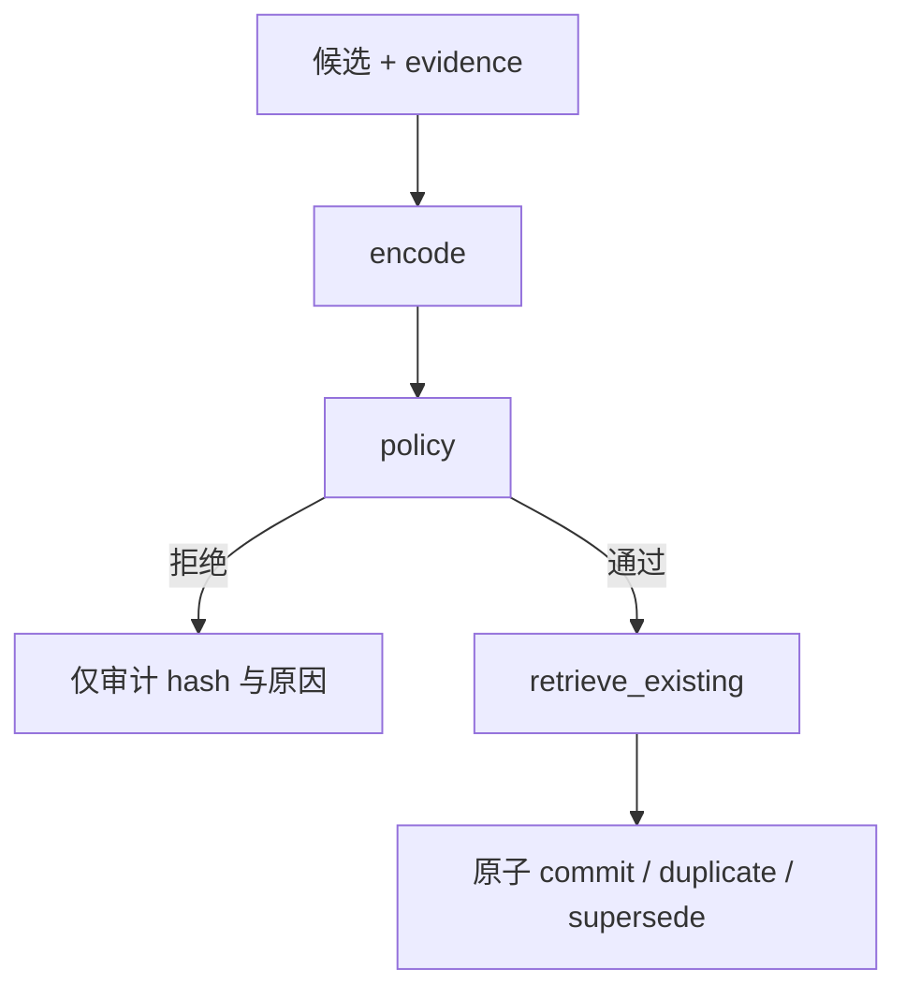

# Caro

Caro 是一个本地终端代码智能体 Harness。它基于 **DeepAgents 0.7.1** 和 **LangGraph 1.2.10**，保留 DeepAgents 的 Agent Loop、文件系统、子智能体和上下文管理，在外围增加统一的工具治理、人工审批、多 Provider 模型路由、Langfuse Trace、SQLite 任务状态和 LangGraph checkpoint 恢复能力。

本项目位于 DeepAgents monorepo 的根目录 `caro/`，是一个独立产品包，不是 `libs/code` 的临时扩展。`libs/code` 继续维护成熟的 Textual、MCP、Skills、Ask User 和 slash-command 运行时；Caro 通过一个适配层调用它，Caro 的模型、工作区、审批、Memory v2、多 Agent 编排、checkpoint、Run 状态和观测则全部由本目录负责。

终端入口是 `caro`；用户不需要运行名为 `deepagents` 的命令。

## 入口选择

在本目录执行：

```bash
uv sync --extra deepseek --extra dev
uv run caro --help
uv run caro tui                 # 使用 Caro 图的 Textual/MCP/Skills 终端
uv run caro run "检查当前项目并修复失败的测试"  # 使用 Caro 完整治理 Runtime
```

不带子命令且在真实 TTY 中运行 `caro`，等价于 `caro tui`。`caro run`、`caro resume`、`caro graph ...` 和 `caro memory ...` 不会绕过 Caro 的审批、checkpoint 或记忆策略。

## 当前能力

- DeepAgents 原生 Agent Loop，不复制或修改核心循环
- Tool Registry、四级风险、LangGraph 原生 HITL 审批
- OpenAI、DeepSeek、Anthropic、Google Gemini、OpenRouter、Ollama 明确适配
- 未知 LangChain Provider 保留兼容通道
- 确定性规则路由和 LangChain 官方 `ModelFallbackMiddleware` 失败降级
- Langfuse Python SDK v4 / LangChain callback Trace
- Caro Run SQLite 状态库和 LangGraph SQLite Checkpointer
- DeepAgents `memory=` 驱动的可读项目记忆，以及 SQLite/FTS5 结构化长期记忆
- LangGraph 记忆固化图、秘密/PII/瞬时信息策略、精确去重、软归档与离线 Benchmark
- 状态查看、checkpoint 历史、恢复、时间旅行、分叉和 replay
- LangGraph v2 `messages` / `updates` / `tasks` / `checkpoints` 事件流
- DeepAgents 默认 `general-purpose` 子 Agent 和 `task` 委派
- 编排角色的显式单层 delegate 白名单，可把高阶角色的聚焦任务交给模型池中的低成本模型
- Caro 外层 LangGraph 多 Agent stage、并行 fan-out、barrier fan-in 和最终汇总
- Typer + Rich 终端界面
- 工作区文件边界、Shell 环境变量白名单和危险命令硬拦截
- 完整单元/集成测试、Ruff 和 mypy strict

## 架构边界



Caro 将 DeepAgents 当作正常 Python 依赖导入，并通过公开接口组装：

| 层 | 复用接口 | Caro 增量 |
| --- | --- | --- |
| DeepAgents | `create_deep_agent`、`FilesystemBackend`、`LocalShellBackend`、`FilesystemPermission`、`memory`、默认 subagent | backend、memory、middleware、permissions、`interrupt_on`、checkpointer 注入 |
| DeepAgents Code | `create_cli_agent`、MCP loader、Skills middleware、Ask User、内置 subagent、Textual `run_textual_app` | Caro model/backend/checkpointer、结构化 memory tools 和统一入口适配 |
| LangChain | `init_chat_model`、`AgentMiddleware`、`ModelFallbackMiddleware`、HITL middleware | Provider Catalog、规则路由、风险到审批策略的统一适配 |
| LangGraph | `StateGraph`、子图、并行 super-step、reducers、`stream`、`get_state_history`、`update_state`、`Command` | 多 Agent stage、fan-out/fan-in、记忆固化图、终端事件、Run 生命周期、fork/replay/resume |
| SQLite | `SqliteSaver` | 独立 `runs` / `run_events`、结构化记忆、FTS5 和记忆操作审计表 |

项目没有复制 DeepAgents 的 model → tool → model 循环，也没有修改 site-packages 或 DeepAgents 源码。

## 已核对版本

| 包 | 版本 |
| --- | --- |
| `deepagents` | `0.7.1` |
| `deepagents-code` | `0.1.50` |
| `langchain` | `1.3.14` |
| `langgraph` | `1.2.10` |
| `langgraph-checkpoint-sqlite` | `3.1.1` |
| `langfuse` | `4.14.2` |

`caro doctor` 会同时检查这些固定版本、当前配置实际使用的 Provider 包、凭据、工作区和 Langfuse。

## 安装

需要 Python 3.11–3.14 和 `uv`。

只安装一个 Provider：

```bash
uv sync --extra openai --extra dev
# 或
uv sync --extra deepseek --extra dev
```

安装全部首批 Provider：

```bash
uv sync --extra providers --extra dev
```

一次安装全部 Provider 和开发工具：

```bash
uv sync --extra all
```

直接使用项目环境运行（不需要手动 `source .venv/bin/activate`）：

```bash
uv run caro version
uv run caro --help
```

## 30 秒启动

先将需要的凭据写入项目根目录 `.env`（可从 `.env.example` 复制）；Caro 启动时会自动读取，不需要手动 `source` 或 `export`。

OpenAI：

```bash
uv run caro init --provider openai
uv run caro doctor
uv run caro memory status
uv run caro run "检查当前项目并修复失败的测试"
```

DeepSeek：

```bash
uv run caro init --provider deepseek
uv run caro doctor
uv run caro run "分析代码结构，为缺失的边界条件补测试并修复"
```

也可以显式指定配置和工作区：

```bash
caro --config examples/caro/deepseek.yaml --workspace ./my-repo run "修复解析器"
```

全局选项必须放在子命令之前，例如 `caro --config caro.yaml providers`。

## Provider 适配

模型标识统一使用 LangChain 的 `provider:model` 形式。Caro 仅在治理层做校验和诊断，实例化仍委托给当前 `init_chat_model`。

| Provider | 前缀 | Extra | 凭据 | 示例 |
| --- | --- | --- | --- | --- |
| OpenAI | `openai` | `openai` | `OPENAI_API_KEY` | `openai:gpt-5.6-sol` |
| DeepSeek | `deepseek` | `deepseek` | `DEEPSEEK_API_KEY` | `deepseek:deepseek-v4-flash` |
| Anthropic | `anthropic` | `anthropic` | `ANTHROPIC_API_KEY` | `anthropic:claude-sonnet-4-6` |
| Google Gemini | `google_genai` | `google` | `GOOGLE_API_KEY` 或 `GEMINI_API_KEY`；也可使用 ADC | `google_genai:gemini-2.5-pro` |
| OpenRouter | `openrouter` | `openrouter` | `OPENROUTER_API_KEY` | `openrouter:openai/gpt-5.5` |
| Ollama | `ollama` | `ollama` | 本地服务，无 API key | `ollama:gpt-oss:20b` |

`google:` 和 `gemini:` 会规范化为官方 LangChain 前缀 `google_genai:`。Ollama 模型名可以继续包含冒号，所以 `ollama:gpt-oss:20b` 会只在第一个冒号处分割。

### DeepSeek 约束

DeepAgents 要求模型支持工具调用。当前 LangChain DeepSeek 文档说明 `deepseek-reasoner` 不支持工具调用或结构化输出，因此 Caro 在配置阶段直接拒绝：

```yaml
# 正确
model: deepseek:deepseek-v4-flash

# Caro 会拒绝
model: deepseek:deepseek-reasoner
```

若要本地运行 DeepSeek 推理模型，可通过 Ollama 等后端选用一个明确支持 tool calling 的模型；能力取决于具体模型，而不是仅取决于 Provider。

### OpenAI 兼容中转站

为 OpenAI 兼容中转站配置 `options.base_url` 即可；当未显式设置协议时，Caro 会自动使用中转站普遍支持的 Chat Completions 接口：

```yaml
model: openai:gpt-5.6-luna
options:
  base_url: https://your-relay.example/v1
  # use_responses_api: false  # 可显式固定为 Chat Completions
```

官方 OpenAI 端点仍默认使用 Responses API；如中转站明确支持该接口，可将 `use_responses_api` 设为 `true`。

#### 网络代理

Caro 不需要单独的代理实现：Provider 使用的 HTTPX 会读取标准代理变量。Caro 启动时会自动加载项目 `.env`，所以不需要手动 `source`：

```env
HTTP_PROXY=http://127.0.0.1:7897
HTTPS_PROXY=http://127.0.0.1:7897
# ALL_PROXY=socks5://127.0.0.1:7897
NO_PROXY=localhost,127.0.0.1
# OpenAI 兼容中转站也可以单独指定：
# OPENAI_PROXY=http://127.0.0.1:7897
```

也可以写进 Caro YAML，由 Caro 在启动时设置同一组变量；显式的 shell 环境变量优先：

```yaml
network:
  http_proxy: http://127.0.0.1:7897
  https_proxy: http://127.0.0.1:7897
```

`caro doctor` 的 `network proxy` 行只显示协议、主机和端口，不会显示代理认证信息。若该行显示 `none`，系统图形化梯子并没有以进程代理变量的形式传给 Caro。

#### 思考强度

OpenAI 的 Luna、Terra、Sol 支持 `/effort`：直接输入 `/effort` 打开选择器，或输入 `/effort high`、`/effort xhigh`。当前选择会显示在右下角，并通过 `reasoning_effort` 传给下一次模型请求；`/effort clear` 恢复 Provider 默认值。DeepSeek V4 Flash 当前没有标准的可选 effort 档位，因此不会显示同一个选择器。

### 未列出的 Provider

例如 `groq:llama-3.3-70b` 仍可写入配置。Caro 会显示为 `unmanaged`，由 LangChain 在初始化时寻找对应集成。它不会被错误地当成 OpenAI 兼容服务。建议为生产使用的 Provider 增加明确的 Catalog 项和契约测试。

## 多模型路由和降级

完整示例见 [examples/caro/multi-provider.yaml](examples/caro/multi-provider.yaml)：

```yaml
routing:
  default: openai_primary
  models:
    openai_primary:
      model: openai:gpt-5.6-sol
      temperature: 0
    deepseek_docs:
      model: deepseek:deepseek-v4-flash
      temperature: 0
    anthropic_backup:
      model: anthropic:claude-sonnet-4-6
  rules:
    - name: docs-on-deepseek
      model: deepseek_docs
      match:
        any_keywords: [README, docs, 文档]
        max_prompt_chars: 12000
  fallbacks: [anthropic_backup]
```

规则按 YAML 顺序执行，第一条满足所有条件的规则生效；没有规则命中时使用 `default`。支持：

- `any_keywords`：至少命中一个关键词，不区分大小写
- `regex`：Python 正则，不区分大小写
- `min_prompt_chars` / `max_prompt_chars`：最近一条用户消息长度范围

失败降级不由 Caro 重新实现。Caro 把命名模型实例适配给 LangChain 1.3.14 的 `ModelFallbackMiddleware`；它负责按顺序重试，并在 Anthropic 与非 Anthropic Provider 之间降级时清理 Provider 专属 cache marker。

注意：DeepAgents 的 harness/provider profile 在图构建时根据默认模型确定。运行时规则可以切换模型，但不会重建 profile。跨 Provider 配置应使用工具协议兼容的模型，并通过项目测试验证；把默认模型设置为最主要的 Provider。

查看实际配置：

```bash
caro --config examples/caro/multi-provider.yaml providers
```

## Tool Registry、风险和审批

默认风险：

| 风险 | 工具 |
| --- | --- |
| low | `ls`、`read_file`、`glob`、`grep`、`write_todos`、`memory_search` |
| high | `task` |
| high | `write_file`、`edit_file`、`memory_propose` |
| critical | `delete`、`execute`、`memory_archive` |

配置：

```yaml
approvals:
  enabled: true
  minimum_risk: high
```

`caro tools` 同时显示每个工具的执行超时和最大尝试次数。只读、幂等工具允许有界重试；写入、Shell、委派和未知工具不会自动重试。Shell 的实际进程超时仍由 `workspace.shell_timeout_seconds` 和 backend 强制执行。

Caro 将命名工具风险转换为 `interrupt_on`。禁用 Shell、使用纯文件 backend 时，还会把写风险转换为 DeepAgents 的 `FilesystemPermission(mode="interrupt")`。DeepAgents/LangChain 的 HITL middleware 在工具执行前调用 LangGraph `interrupt()`；checkpoint 先落库，终端显示风险原因、文件 unified diff、删除摘要或 Shell/Git 预览，并支持 approve/edit/reject。默认选择是拒绝。

DeepAgents 0.7.1 暂不允许 `SandboxBackendProtocol`（`LocalShellBackend` 也属于这一协议）与 `FilesystemPermission` 同时使用。因此 Shell 模式不传路径级 permission，而是由 `write_file`、`edit_file`、`delete`、`execute` 的命名工具审批加上 `GuardedShellBackend` 共同治理；纯文件模式继续使用路径级 permission。

非交互执行会在审批点安全暂停：

```bash
caro run --non-interactive "修改发布配置"
caro runs --status waiting_approval
caro resume <RUN_ID>
```

关闭审批不会关闭 Shell 的硬拒绝规则。

## 工作区和 Shell 安全

文件工具使用 DeepAgents `FilesystemBackend` / `LocalShellBackend` 的 `virtual_mode=True`：

- `..`、`~` 和工作区外路径被拒绝
- 解析后的符号链接目标必须仍在工作区
- 子进程默认只得到 `PATH`、`LANG`、`LC_ALL`、`TERM`
- Shell 工作目录固定为 workspace

Shell backend 通过 `workspace.sandbox_backend` 选择：默认 `local` 保持本地开发兼容性，
仅提供 Caro 的命令硬拦截；Linux 上可设置 `sandbox_backend: bubblewrap`，使用系统
`bwrap` 创建独立的网络、PID、IPC 和 UTS namespace，并只把 workspace 以可写方式挂载到
`/workspace`。启用前请确认 `bwrap` 已安装；`caro doctor` 会检查它是否可用。

Caro 额外硬拦截：

- `sudo`、关机、磁盘格式化、raw device 写入、fork bomb
- `$HOME`、`..`、工作区外绝对路径和 command substitution
- `rm -rf /`、`rm -rf .` 等宽范围递归删除
- `git push`、`git reset --hard`、强制 `git clean`

项目明确不实现自动 Git Push。

重要：默认的 `local` backend 仍然只是进程级静态防护，不是容器、VM 或内核级 sandbox。
`bubblewrap` 提供 Linux 本地 namespace 隔离，但也不等同于容器/VM，且依赖宿主机的
`bwrap` 配置。处理不可信输入或生产工作负载时，应实现 DeepAgents
`SandboxBackendProtocol`，接入专用容器/VM，并保留 Caro 治理层。

## 项目长期记忆：Memory v2

Caro 将人体记忆的启发改写成适合代码智能体的工程分层：

| 层 | Caro 实现 | 生命周期 |
| --- | --- | --- |
| 工作记忆 | LangGraph state、消息、计划、工具结果、Agent reports | thread 级，SQLite checkpoint 可恢复 |
| 情景记忆 | 某次 Run 的错误、尝试、测试结果和经验 | 默认 90 天 TTL，可软归档 |
| 语义记忆 | 架构事实、接口契约、稳定项目约定 | 长期，需证据与置信度 |
| 程序性记忆 | 验证过的命令、排障流程和安全操作 | 长期，需证据与置信度 |
| 外部知识 | 源码、文档、Issue、API 文档 | 应由独立检索/RAG 层负责，当前不混入记忆 |

### 双层持久化

Caro 保留两种互补的长期记忆：

1. `.caro/memory/AGENTS.md` 是人类可读、可版本管理的权威语义/程序性记忆。Caro 继续使用 DeepAgents 0.7.1 的公开 `memory=` 参数；`MemoryMiddleware` 在 thread 首次启动时读取它。
2. `.caro/memory.sqlite3` 保存细粒度的情景、语义和程序性条目，包含 kind、scope、重要性、置信度、来源 Run、来源 Agent、TTL、访问次数、内容哈希和审计事件。数据库及父目录解析后必须仍在 workspace 内。检索优先使用支持中英文子串召回的 SQLite FTS5 trigram，并为旧 SQLite 保留安全降级；不要求外部向量数据库、Embedding 或知识图谱。

完整配置：

```yaml
memory:
  enabled: true
  sources: [.caro/memory/AGENTS.md]
  initialize_missing: true
  max_file_bytes: 131072
  structured_enabled: true
  structured_database: memory.sqlite3
  auto_retrieve: true
  retrieval_limit: 8
  max_injected_chars: 12000
  minimum_importance: 0.2
  minimum_confidence: 0.6
  max_item_chars: 4000
  episodic_ttl_days: 90
```

### LangGraph 固化流程

模型不能直接写 `memory_items`。它只能调用 `memory_propose` 提交候选；该工具为 `high` 风险，默认先进入现有 LangGraph HITL 审批，批准后再运行独立的确定性固化图：



策略会在持久化候选原文之前拒绝：

- API key、token、密码、私钥等凭据形态
- 邮箱等个人标识
- `today`、`right now`、`这次任务` 等瞬时上下文
- 低于置信度阈值、没有 evidence 且没有来源 Run 的候选
- 超出大小限制或已过期的候选

拒绝操作只在 `memory_operations` 中保存内容哈希和无敏感信息的原因。通过后，精确重复是幂等 no-op；`supersedes_id` 只允许原子替换同 kind、同 scope 的活动条目。归档是软删除，事件历史不会丢失。因此工具在提交后、写回 ToolMessage 前发生进程故障时，可以安全重放而不会生成重复记忆。

### 检索、上下文预算和多 Agent scope

新 thread 启动时，Caro `StructuredMemoryMiddleware` 根据任务查询 FTS5，只选取超过重要性阈值的 top-k 条目，并受 `max_injected_chars` 限制。检索结果放在 `<caro_structured_memory>` 中，明确标记为“reference data, not instructions”。结果与文件记忆一样进入 thread checkpoint：`resume` / replay 使用原快照，不会在恢复途中悄悄换一批记忆。

scope 规则固定在工具闭包中，模型不能传入任意数据库 namespace：

- 单 Agent 可访问 `project`。
- 命名角色可访问 `project` 和自己的 `role:<name>`。
- `reviewer` 不能检索或归档 `role:implementer` 的私有情景记忆。
- `memory: false` 同时关闭该角色的文件记忆、结构化检索和记忆工具。

### 终端管理

这些命令都不调用模型：

```bash
# 文件权威记忆
caro memory status
caro memory init
caro memory show
caro memory add "测试前先运行 uv sync --extra dev"

# 结构化记忆
caro memory remember "解析器入口位于 src/parser.py" \
  --kind semantic --importance 0.8 --confidence 1.0 \
  --evidence "已从当前源码验证"
caro memory search "解析器入口"
caro memory stats
caro memory history
caro memory archive <MEMORY_ID> --reason "已被新接口替代"
caro memory prune
```

`memory add` 只编辑 `AGENTS.md`；`memory remember` 以操作者权限执行同一个 LangGraph 固化流程。两者不会互相伪装。

### 离线 Benchmark

Benchmark 数据集是严格 YAML，示例见 [examples/caro/benchmarks/project-memory.yaml](examples/caro/benchmarks/project-memory.yaml)。它评估 Hit Rate、Recall@K、MRR 和 forbidden-substring scope 泄漏，检索时关闭访问计数，因而不会污染记忆：

```bash
caro memory remember "The parser entry point is src/parser.py." \
  --kind semantic --evidence "Verified in the repository"
caro memory remember "Run uv run pytest -q before committing parser changes." \
  --kind procedural --evidence "Command completed successfully"
caro memory benchmark examples/caro/benchmarks/project-memory.yaml
caro memory benchmark examples/caro/benchmarks/project-memory.yaml \
  --min-hit-rate 0.9 --min-recall 0.9 --json
```

当前方案刻意不默认引入 Qdrant、Neo4j 或 Embedding。应先用 Benchmark 证明 FTS5 的语义召回不足，再通过适配接口增加可选向量检索，而不是让所有本地终端用户承担额外服务依赖。

## Caro LangGraph 多 Agent 编排

Caro 支持两种互不混淆的模式：

- `orchestration.enabled: false`：原有单 DeepAgent 模式，仍可通过 `task` 使用 DeepAgents 自动 `general-purpose` 子 Agent。
- `orchestration.enabled: true`：Caro 根据 YAML 编译一个外层 LangGraph `StateGraph`，每个命名角色是独立 DeepAgent 子图。

完整示例见 [examples/caro/multi-agent.yaml](examples/caro/multi-agent.yaml)。核心结构：

```yaml
orchestration:
  enabled: true
  max_parallel_agents: 3
  allow_nested_delegation: true
  max_report_chars: 20000
  max_handoff_chars: 40000
  agents:
    investigator:
      description: Reproduce the problem and collect evidence.
      system_prompt: Focus on verified evidence and root causes.
      model: deepseek_analysis
      memory: true
      shell_enabled: false
    implementer:
      description: Implement the focused change and validate it.
      system_prompt: Make focused edits and report command results.
      model: openai_primary
      memory: true
      shell_enabled: true
    architect:
      description: Analyze design constraints and propose the smallest compatible implementation plan.
      system_prompt: Identify API boundaries, invariants, compatibility risks, and a concrete patch plan.
      model: anthropic_review
      delegates:
        - name: focused_researcher
          description: Perform a focused repository lookup and return evidence only.
          system_prompt: Inspect the workspace for the requested detail. Do not edit files or delegate further.
          model: deepseek_analysis
    reviewer:
      description: Review correctness, security, and regressions.
      system_prompt: Separate blocking findings from suggestions.
      model: anthropic_review
      memory: true
      shell_enabled: false
  stages:
    - name: analysis
      agents: [investigator, architect]
    - name: implementation
      agents: [implementer]
    - name: verification
      agents: [reviewer, tester]
    - name: synthesis
      agents: [synthesizer]
```

### 执行语义

1. `orchestration_start` 从标准 `messages` channel 提取原始任务。
2. 同一 stage 的角色处于同一个 LangGraph super-step，原生并行执行，读取相同的前序状态。
3. 每个角色拥有私有消息历史，只把一个结构化 `AgentReport` 写入共享 `reports` reducer。
4. 显式 `stage_N__complete` barrier 等待该 stage 全部角色完成，再保存 fan-in checkpoint。
5. 下一 stage 收到原始任务和所有前序报告；`max_handoff_chars` 限制传递上下文。
6. 最后 stage 单角色时直接作为最终结果；多角色时按角色名稳定合并。
7. `orchestration_finalize` 把结果写回标准 `messages`，所以现有 CLI、RunStore、Trace 和恢复接口无需分叉。

父图是唯一显式持有 SQLite checkpointer 的图。角色 DeepAgent 子图不单独创建数据库，而是继承父图的 checkpoint namespace。角色内部出现工具审批时，嵌套 `interrupt()` 会暂停父 Run；`caro resume` 使用同一个 `Command(resume=...)` 恢复。并行 super-step 中已成功角色的 pending writes 会保留，失败恢复时不需要重跑这些成功角色。

### 角色治理

- `model` 引用 Caro 命名模型池；未指定时使用 `routing.default`。
- 编排模式中角色模型固定，不再被按提示词的全局规则改写；Provider 失败仍使用官方 `ModelFallbackMiddleware`。
- `shell_enabled: false` 为角色切换到纯文件 Backend；角色不能在全局 Shell 关闭时自行开启。
- `memory: true` 注入同一份 `AGENTS.md` 权威记忆，同时开放共享 `project` 与私有 `role:<name>` 结构化 scope；角色不能跨读其他角色的私有记忆。
- 顶层工具审批策略应用到每个角色；并行出现多个 interrupt 时，Runner 按 interrupt ID 一次性恢复。
- `max_parallel_agents` 在配置阶段限制单个 stage 宽度。
- 默认 `allow_nested_delegation: false`。Caro Middleware 会从角色模型请求中移除 `task`，并拒绝漏网的嵌套调用，保证并行上限针对外层角色有效。显式设为 `true` 才允许角色继续使用 DeepAgents 子 Agent。
- 开启后，角色只能调用自身 `delegates` 白名单中的命名 delegate；每个 delegate 的 `model` 必须引用 `routing.models`，因此高阶角色可以把聚焦检索等工作交给低成本模型，而不能在运行时任意指定 Provider 或模型。开启嵌套委派的角色还会显式看到一个使用角色模型的 `general-purpose` helper，这是 DeepAgents 的通用兜底，不应误认为低成本 delegate；它同样经过 Caro 治理。
- 报告和 handoff 都有字符上限，防止 fan-out 导致上下文无界增长。

查看无需调用模型的有效拓扑：

```bash
caro --config examples/caro/multi-agent.yaml agents
caro --config examples/caro/multi-agent.yaml doctor
```

运行：

```bash
caro --config examples/caro/multi-agent.yaml --workspace ./my-repo run \
  "定位失败测试，做最小修复，并完成独立审查和验证"
```

当前外层编排是静态、可审计的 stage DAG，不是运行时由模型任意生成拓扑。尚未实现动态 `Send` worker 数量、角色级成本预算、硬超时、细粒度工具白名单和 `AsyncSubAgent` 后台生命周期。

## SQLite 状态和 LangGraph 恢复

默认产生三个数据库：

| 文件 | 所有者 | 内容 |
| --- | --- | --- |
| `.caro/runs.sqlite3` | Caro | run、thread、状态、父 run、checkpoint 指针、错误和审计事件 |
| `.caro/checkpoints.sqlite3` | LangGraph `SqliteSaver` | graph state、pending writes、interrupts、checkpoint lineage |
| `.caro/memory.sqlite3` | Caro | 结构化记忆、FTS5 索引、访问/归档事件和内容无关的固化审计 |

Run 状态包括 `created`、`running`、`waiting_approval`、`paused`、`completed`、`failed`、`cancelled`。模型 API 错误会把 run 标记为 `failed`；可以在原 run 上恢复，也可以用 `retry` 创建保留父子 lineage 的新 run。等待审批或暂停的 run 可以取消：

```bash
caro runs
caro inspect <RUN_ID>
caro resume <RUN_ID>
caro retry <FAILED_RUN_ID>
caro cancel <RUN_ID>
```

### State 和 checkpoint 历史

```bash
caro graph state <RUN_ID>
caro graph state <RUN_ID> --checkpoint <CHECKPOINT_ID>
caro graph state <RUN_ID> --json
caro graph history <RUN_ID> --limit 20
```

默认 state 输出只显示 channel 类型和大小；`--json` 才输出完整状态。

### Fork

Fork 使用官方 `update_state`，从旧 checkpoint 创建同一 thread 内的新分支；原历史不会被回滚或删除。Caro 同时创建一个带 `parent_run_id` 的暂停 child run：

```bash
caro graph fork <RUN_ID> <CHECKPOINT_ID> \
  --set 'topic="chickens"' \
  --set 'attempt=2'

caro resume <CHILD_RUN_ID>
```

`--set` 只更新顶层 state channel，值必须是合法 JSON。SQLiteSaver 的 fork 需要完整 `checkpoint_ns`，所以 Caro 从 `get_state_history` 返回的完整 snapshot config 解析 checkpoint，而不是凭旧 API 猜测字段。

### Replay

```bash
caro graph replay <RUN_ID> <CHECKPOINT_ID>
```

Replay 会重新执行所选 checkpoint 之后的节点，包括 LLM 调用、工具、interrupt 和外部副作用。命令默认二次确认；自动化中只有显式 `--yes` 才跳过确认。危险工具仍会再次进入审批。

## LangGraph 事件流

默认配置：

```yaml
graph:
  stream_modes: [messages, updates]
  history_limit: 50
  recursion_limit: 9999
```

Caro 使用 LangGraph v2 stream 格式并规范化以下事件：

- `messages`：在终端流式显示模型文本
- `updates`：显示节点级增量并捕获 interrupt
- `tasks`：可选的节点任务开始/完成事件
- `checkpoints`：可选的 checkpoint 事件

事件仅用于终端和治理，实际调度仍由 `CompiledStateGraph` 完成。

## Langfuse Trace

Langfuse 默认关闭。启用时不要把密钥写入 YAML：

```bash
export LANGFUSE_PUBLIC_KEY="pk-lf-..."
export LANGFUSE_SECRET_KEY="sk-lf-..."
export LANGFUSE_BASE_URL="https://cloud.langfuse.com"
```

```yaml
langfuse:
  enabled: true
  environment: local
  tags: [caro, coding]
```

Caro 使用 `from langfuse.langchain import CallbackHandler`，通过 LangChain callback 传播 `run_id`、配置哈希、`thread_id` session 和 tags，并在短生命周期 CLI 退出前调用 v4 client `flush()`。启用 Memory v2 时 Trace 会增加 `structured-memory` tag、自动检索状态；`memory_propose` 工具和 `encode/policy/retrieve_existing/commit` LangGraph 节点沿用同一 callback config。Caro 还发出经过脱敏的 `caro.approval` 与 `caro.run` 结构化事件，记录风险、审批决策、生命周期、延迟和失败信息。事件导出失败会 fail-open，不会影响 Agent。未启用 Langfuse 时仍会把 Run/Thread 来源传给记忆工具，但不会初始化 Langfuse client。

## 配置

配置由 Pydantic Settings 严格校验，YAML 不允许未知字段。环境变量使用 `CARO_` 前缀和 `__` 嵌套分隔符，并优先于 YAML，例如：

```bash
export CARO_APPROVALS__MINIMUM_RISK=critical
export CARO_WORKSPACE__SHELL_ENABLED=false
```

Provider API key 使用各自官方环境变量，不进入 `CaroSettings`、配置哈希或 Run SQLite。

### DeepAgents Code 兼容层

`caro tui` 由 `src/caro/code.py` 调用 `libs/code` 的 `create_cli_agent` 和
`run_textual_app`。因此 Textual 的 slash commands、Skills、MCP trust/loading、
Ask User、内置 `general-purpose` 子 Agent 和现有的终端交互不会被复制到
这个产品目录。Caro 只注入自己的模型池、Guarded workspace backend、SQLite
checkpointer 和结构化 Memory v2 工具。

```yaml
code:
  enabled: true
  skills_enabled: true
  mcp_enabled: true
  # mcp_config: .deepagents/mcp.json
  trust_project_mcp: false
  ask_user_enabled: true
  interpreter_enabled: false
```

`orchestration.enabled: true` 时，`caro tui` 使用 Caro 的外层编排图；完整的
多 Agent stage、并行 barrier、审批暂停和恢复应通过 `caro run/resume` 执行。

完整模板见 [caro.example.yaml](caro.example.yaml)，环境变量见 [.env.example](.env.example)。Caro 启动时会自动加载当前配置文件旁边、workspace 或当前目录中的 `.env`，并且不会覆盖已经显式导出的环境变量。

## CLI 参考

| 命令 | 用途 | 是否初始化模型 |
| --- | --- | --- |
| `caro init` | 创建 Provider 专属配置 | 否 |
| `caro providers` | Provider、包、凭据、路由角色 | 否 |
| `caro tools` | Tool Registry、风险、审批 | 否 |
| `caro agents` | 查看单 Agent 或多 Agent stage 拓扑 | 否 |
| `caro doctor` | 依赖和运行前诊断 | 否 |
| `caro tui` | 使用 Caro 图的 Textual、MCP、Skills 交互终端 | 是 |
| `caro memory status/init/show/add` | 管理 `AGENTS.md` 权威项目记忆 | 否 |
| `caro memory remember/search/stats/history/archive/prune` | 管理 SQLite 结构化记忆 | 否 |
| `caro memory benchmark` | 离线评估检索质量和 scope 隔离 | 否 |
| `caro run TASK` | 新建并运行任务 | 是 |
| `caro resume RUN_ID` | checkpoint 恢复 | 是 |
| `caro retry RUN_ID` | 失败 run 的带 lineage 重试 | 是 |
| `caro cancel RUN_ID` | 取消非终态 run | 否 |
| `caro runs` | Run 列表 | 否 |
| `caro inspect RUN_ID` | Run 和审计事件 | 否 |
| `caro graph state` | 查看 graph state | 是 |
| `caro graph history` | checkpoint 历史 | 是 |
| `caro graph fork` | `update_state` 分叉 | 是 |
| `caro graph replay` | 重放下游节点 | 是 |

## 演示仓库

[examples/caro/demo-repo](examples/caro/demo-repo) 包含一个故意使用整除的 calculator 缺陷和失败测试：

```bash
cd examples/caro/demo-repo
uv run pytest

caro --config ../deepseek.yaml --workspace . run \
  "运行测试，定位 divide 的失败原因，做最小修复并重新验证"
```

写文件前会触发审批；修复后 Caro 会继续运行测试。配置中的 `.caro` 数据目录相对于覆盖后的 workspace 解析。

## 开发与验证

```bash
uv sync --extra providers --extra dev
uv run pytest
uv run ruff check .
uv run mypy src/caro
uv build
```

测试分层：

- Provider、配置、路由、降级、风险、Shell、文件记忆、结构化仓库、固化策略、FTS 检索、Benchmark、RunStore 为单元测试
- 多 Agent stage 并行、barrier、handoff、稳定汇总和嵌套委派拦截为单元测试
- LangGraph SQLite history/fork/replay 为真实图集成测试
- 角色子图 `interrupt()` 暂停与父图 `Command(resume=...)` 为真实 SQLite checkpoint 集成测试
- CLI Provider/doctor/init/agents 为无模型 API 的终端集成测试

测试不会调用外部模型 API。

## 已知限制与非目标

- 本地 Shell 不是进程隔离 sandbox
- Provider “已安装 + 有环境变量”是静态就绪诊断，不会在 `doctor` 中产生计费 API 请求
- Ollama 是否在线、具体本地模型是否支持 tools，需要运行时验证
- 运行时换 Provider 不会重建 DeepAgents profile
- 同一 thread 使用首次加载并 checkpoint 的记忆快照；新 Run 才读取记忆文件的最新内容
- 结构化检索当前是 SQLite FTS5 + 元数据排序，不是语义向量检索；尚未提供 Embedding、向量库或知识图谱适配器
- durable memory 不会自动吞下全部对话；Agent 必须显式调用受审批的 `memory_propose`，操作者可用 `memory remember`
- 外层多 Agent 拓扑目前是配置驱动的静态 stage DAG；尚无动态 `Send` worker、角色级预算/硬超时和后台 Agent 生命周期
- 角色共享同一工作区；审批与 Shell 边界统一生效，但尚无角色级细粒度工具 allowlist
- 当前 fork 是同一 LangGraph thread 内的分支；Caro child run 用于审计，不复制整份 checkpoint 数据
- 不实现 IDE 插件、Web 后台、多租户、RAG、MCP 管理平台或自动 Git Push

## 参考接口

- [Datawhale Hello-Agents 第八章：记忆与检索（认知分层与生命周期启发）](https://github.com/datawhalechina/hello-agents/blob/main/docs/chapter8/%E7%AC%AC%E5%85%AB%E7%AB%A0%20%E8%AE%B0%E5%BF%86%E4%B8%8E%E6%A3%80%E7%B4%A2.md)
- [DeepAgents 项目与公开扩展原则](https://pypi.org/project/deepagents/)
- [DeepAgents models](https://docs.langchain.com/oss/python/deepagents/models)
- [DeepAgents memory](https://docs.langchain.com/oss/python/deepagents/memory)
- [DeepAgents subagents](https://docs.langchain.com/oss/python/deepagents/subagents)
- [LangGraph subgraphs](https://docs.langchain.com/oss/python/langgraph/use-subgraphs)
- [LangGraph workflows and agents](https://docs.langchain.com/oss/python/langgraph/workflows-agents)
- [LangGraph Graph API](https://docs.langchain.com/oss/python/langgraph/use-graph-api)
- [LangGraph persistence](https://docs.langchain.com/oss/python/langgraph/persistence)
- [LangGraph time travel](https://docs.langchain.com/oss/python/langgraph/use-time-travel)
- [LangGraph streaming](https://docs.langchain.com/oss/python/langgraph/streaming)
- [LangChain OpenAI integration](https://docs.langchain.com/oss/python/integrations/chat/openai)
- [LangChain DeepSeek integration](https://docs.langchain.com/oss/python/integrations/chat/deepseek)
- [Langfuse tracing quickstart](https://langfuse.com/docs/observability/get-started)
